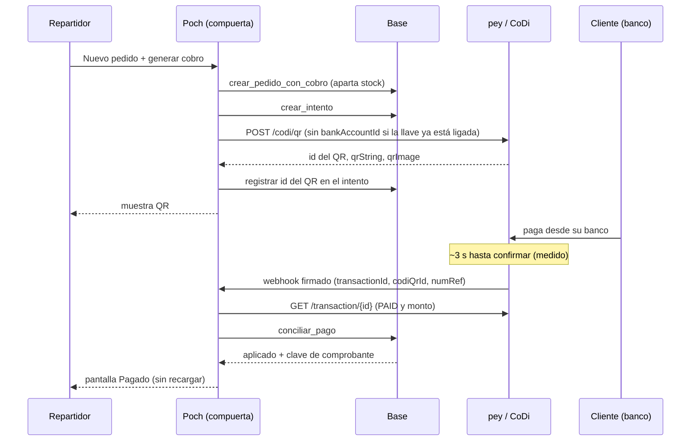

# Poch · cobro en ruta con CoDi

**Poch** (por *Pochteca*, los comerciantes que recorrían rutas en Mesoamérica) convierte el celular de un repartidor en su terminal de cobro. El repartidor arma el pedido con piezas de su camioneta, el sistema genera un QR de CoDi, el cliente paga desde la app de su banco y el dinero va **directo de la cuenta del cliente a la cuenta de la empresa**. Cuando llega la confirmación, el stock de la camioneta baja y la empresa ve todo en tiempo real.

Proyecto del **Cursor Hackatón México (CDMX, 14–15 de noviembre de 2026)**, construido con la API de pey.

> **Demostración con datos ficticios. Sin validez fiscal.** Empresa, repartidores, clientes y catálogo son inventados. Los precios están en centavos porque las pruebas con pey son en producción y no se devuelven.

## El problema

En refaccionarias con venta en ruta, el repartidor cobra en efectivo o pide una transferencia a una CLABE personal. El dinero tarda en cuadrar, el stock de la camioneta no se actualiza al momento y la empresa no ve el cobro hasta horas después. Poch deja que el celular del repartidor cobre con CoDi a nombre de la empresa.

## Recorrido de un cobro



## Reglas de conciliación

Un pago se **aplica** solo si el cobro no está pagado, vencido ni cancelado, el monto es igual al importe y llegó dentro de la vigencia del intento (más 30 segundos). Si no, queda como discrepancia (`monto_distinto`, `fuera_de_vigencia`, `duplicado`, `cobro_cancelado`, `sin_cobro`) para que el administrador lo resuelva.

Se liga el pago al intento por el **id del QR** (`codiQrId`) y por **`numRef`** (sí viaja al banco del pagador). Como segunda llave, `intento_id` en `externalMetadata`. La conciliación periódica usa `GET /transaction/codi/qr/{qrId}` (lista vacía = aún no pagó).

## Seguridad y privacidad

- El navegador solo usa supabase-js para iniciar sesión. Todo lo demás pasa por Edge Functions con el rol de servicio.
- RLS activo sin políticas; `anon` y `authenticated` no leen ni escriben tablas.
- Del pagador se guardan banco, tipo de cuenta, últimos 4 de la CLABE y clave de rastreo. Nunca la CLABE completa ni el teléfono del aviso.
- Un aviso de pey con firma inválida o con fecha fuera de 5 minutos se rechaza con 401 y no se guarda nada.
- La bitácora solo admite agregar y encadena huellas. `verificar_integridad()` **detecta** alteraciones; no las impide a quien administra la base.
- Aviso de privacidad (LFPDPPP): esta demostración trata datos ficticios. En un producto real, la empresa es responsable del tratamiento; se recogen solo los datos necesarios para cobrar y conciliar; el cliente puede ejercer derechos ARCO ante la empresa; no se comparten CLABEs completas ni teléfonos.

## Qué está verificado frente a pey y qué es supuesto

Resumen vivo en [`docs/PEY-VERIFICADO.md`](docs/PEY-VERIFICADO.md). Verificado con pago real de **$0.01 el 14-nov-2026**: respuesta de `POST /codi/qr`, no enviar `bankAccountId` si la llave está ligada, liga por `codiQrId`/`numRef`, `GET /transaction/codi/qr/{id}`, tiempo de 3 segundos y datos del pagador. Siguen abiertos: reintentos del webhook, devoluciones por API y vigencia máxima del QR.

## Limitaciones de la demostración

- Un solo ambiente. Un producto real tendría desarrollo, QA y producción separados.
- Sin sandbox de pey: las pruebas mueven dinero real (centavos).
- La API de pey es gratuita «por el momento».
- Precios del catálogo de $0.01 a $0.05.
- Sin disputas, devoluciones por API, tarjeta, correo, edición de stock en pantalla ni facturación fiscal (siguiente fase).

## Instalación

1. Cree un proyecto de Supabase (Postgres 16) y anote la URL y las llaves.
2. En el editor SQL, corra **en este orden**: Bloque 1, Bloque 2, Bloque 2b (ajuste del pago real), Bloque 2c (un solo QR vigente por cobro), cree los tres usuarios en Authentication, Bloque 3.
3. Usuarios de demostración (contraseña la define usted en el panel): `admin@demo.invalid`, `repartidor1@demo.invalid`, `repartidor2@demo.invalid`.
4. Despliegue las Edge Functions de `supabase/functions/` y configure los secretos (nombres en `.env.example`).
5. Registre en pey la URL pública de `webhook-pey`.
6. Despliegue el frontend (`npm run build`) con `VITE_SUPABASE_URL` y `VITE_SUPABASE_PUBLISHABLE_KEY`.
7. Copias listas también en `supabase/sql/` (`01-esquema`, `02-logica`, `02b-pago-real`, `02c-intento-unico-vigente`, `datos-demo`). Las mismas migraciones están en `supabase/migrations/`.

### Variables

| Nombre | Dónde | Notas |
| --- | --- | --- |
| `PEY_API_KEY` | Secretos de funciones | Obligatoria para cobrar |
| `PEY_WEBHOOK_SECRET` | Secretos de funciones | Obligatoria para avisos |
| `PEY_BANK_ACCOUNT_ID` | Secretos de funciones | **Opcional.** Solo si la llave no está ligada a una cuenta |
| `PEY_CUENTA_ULTIMOS4` | Secretos de funciones | Últimos 4 de la CLABE de la empresa (comprobante del cliente) |
| `PEY_EMPRESA_NOMBRE` | Secretos de funciones | Nombre en el comprobante público |
| `SITE_URL` | Secretos de funciones | Origen permitido en CORS |
| `VITE_SUPABASE_URL` | Frontend | Pública |
| `VITE_SUPABASE_PUBLISHABLE_KEY` | Frontend | Pública |

### Bloque 1 · esquema

```sql
-- BLOQUE 1 · ESQUEMA (tablas, bitácora con cadena de huellas, permisos)
create extension if not exists pgcrypto with schema extensions;

create table public.perfiles (
  user_id uuid primary key references auth.users(id),
  rol text not null check (rol in ('admin','repartidor')),
  nombre text not null,
  activo boolean not null default true,
  creado_en timestamptz not null default now()
);

create table public.productos (
  id uuid primary key default gen_random_uuid(),
  sku text not null unique,
  nombre text not null,
  precio numeric(12,2) not null check (precio > 0),
  activo boolean not null default true
);

create table public.movimientos_stock (
  id bigint generated always as identity primary key,
  repartidor_id uuid not null references public.perfiles(user_id),
  producto_id uuid not null references public.productos(id),
  tipo text not null check (tipo in ('carga','apartado','liberacion','salida','ajuste')),
  cantidad int not null check (cantidad <> 0 and (tipo = 'ajuste' or cantidad > 0)),
  pedido_id uuid,
  actor text not null,
  ocurrio_en timestamptz not null default now()
);

create table public.operaciones (
  operacion_id uuid primary key,
  tipo text not null,
  actor text not null,
  resultado jsonb,
  creado_en timestamptz not null default now()
);

create table public.pedidos (
  id uuid primary key default gen_random_uuid(),
  folio bigint generated always as identity unique,
  repartidor_id uuid not null references public.perfiles(user_id),
  cliente_alias text not null check (char_length(cliente_alias) between 1 and 60),
  total numeric(12,2) not null check (total > 0),
  estado text not null default 'por_cobrar'
    check (estado in ('por_cobrar','pagado','entregado','cancelado')),
  creado_en timestamptz not null default now(),
  actualizado_en timestamptz not null default now()
);

create table public.pedido_lineas (
  id uuid primary key default gen_random_uuid(),
  pedido_id uuid not null references public.pedidos(id),
  producto_id uuid not null references public.productos(id),
  cantidad int not null check (cantidad > 0),
  precio_unitario numeric(12,2) not null check (precio_unitario > 0),
  subtotal numeric(12,2) not null check (subtotal > 0)
);

create table public.cobros (
  id uuid primary key default gen_random_uuid(),
  pedido_id uuid not null unique references public.pedidos(id),
  importe numeric(12,2) not null check (importe > 0),
  concepto text not null,
  vigencia_hasta timestamptz not null,
  estado text not null default 'emitido'
    check (estado in ('emitido','en_proceso','pagado','vencido','cancelado')),
  pagado_en timestamptz,
  creado_en timestamptz not null default now(),
  actualizado_en timestamptz not null default now()
);

create sequence public.numref_seq minvalue 1 maxvalue 9999999 cycle;

create table public.intentos_pago (
  id uuid primary key default gen_random_uuid(),
  cobro_id uuid not null references public.cobros(id),
  metodo text not null check (metodo in ('qr','push')),
  num_ref text not null unique check (num_ref ~ '^[0-9]{1,7}$'),
  pey_id text,
  pey_codi_id text,
  pey_transaction_id text,
  monto numeric(12,2) not null,
  estado text not null default 'creado'
    check (estado in ('creado','pagado','expirado','error')),
  creado_en timestamptz not null default now(),
  expira_en timestamptz not null,
  pagado_en timestamptz
);

create table public.eventos_pey (
  id uuid primary key default gen_random_uuid(),
  webhook_id text not null unique,
  tipo text,
  firma_valida boolean not null,
  payload jsonb not null,
  recibido_en timestamptz not null default now(),
  procesado boolean not null default false,
  resultado text
);

create table public.pagos_confirmados (
  id uuid primary key default gen_random_uuid(),
  pey_transaction_id text not null unique,
  fuente text not null check (fuente in ('webhook','conciliacion')),
  intento_id uuid references public.intentos_pago(id),
  cobro_id uuid references public.cobros(id),
  monto numeric(12,2) not null,
  pagado_en timestamptz not null,
  resultado text not null check (resultado in
    ('aplicado','monto_distinto','fuera_de_vigencia','duplicado','sin_cobro','cobro_cancelado')),
  pagador_banco text,
  pagador_clabe_ultimos4 text,
  clave_rastreo text,
  resolucion text check (resolucion in ('aceptado','devolucion_pendiente','devuelto')),
  nota_resolucion text,
  resuelto_por text,
  resuelto_en timestamptz,
  recibido_en timestamptz not null default now()
);

create unique index un_pago_aplicado_por_cobro on public.pagos_confirmados (cobro_id)
  where resultado = 'aplicado' or resolucion = 'aceptado';

create table public.bitacora (
  id bigint generated always as identity primary key,
  ocurrio_en timestamptz not null default now(),
  actor text not null,
  accion text not null,
  pedido_id uuid,
  cobro_id uuid,
  operacion_id uuid,
  detalle jsonb not null default '{}'::jsonb,
  hash_previo text,
  hash text not null default ''
);

create index on public.movimientos_stock (repartidor_id, producto_id);
create index on public.pedidos (repartidor_id, estado);
create index on public.intentos_pago (cobro_id);
create index on public.bitacora (cobro_id);
create index on public.bitacora (pedido_id);

-- Bitácora: solo agregar, con cadena de huellas (cada fila incluye la huella de la anterior)
create or replace function public.bitacora_encadenar()
returns trigger language plpgsql
set search_path = public, extensions as $$
declare v_prev text;
begin
  perform pg_advisory_xact_lock(7001);
  select b.hash into v_prev from public.bitacora b order by b.id desc limit 1;
  new.hash_previo := v_prev;
  new.hash := encode(digest(
    coalesce(v_prev,'') || '|' || new.id::text || '|' ||
    to_char(new.ocurrio_en at time zone 'UTC','YYYY-MM-DD"T"HH24:MI:SS.US') || '|' ||
    new.actor || '|' || new.accion || '|' ||
    coalesce(new.pedido_id::text,'') || '|' || coalesce(new.cobro_id::text,'') || '|' ||
    coalesce(new.operacion_id::text,'') || '|' || new.detalle::text, 'sha256'), 'hex');
  return new;
end $$;

create trigger bitacora_encadena before insert on public.bitacora
for each row execute function public.bitacora_encadenar();

create or replace function public.solo_agregar()
returns trigger language plpgsql as $$
begin
  raise exception 'La tabla % solo admite agregar filas', tg_table_name;
end $$;

create trigger bitacora_no_modificar before update or delete on public.bitacora
for each row execute function public.solo_agregar();
create trigger bitacora_no_vaciar before truncate on public.bitacora
for each statement execute function public.solo_agregar();
create trigger stock_no_modificar before update or delete on public.movimientos_stock
for each row execute function public.solo_agregar();
create trigger stock_no_vaciar before truncate on public.movimientos_stock
for each statement execute function public.solo_agregar();

-- Stock derivado: se reconstruye siempre desde los movimientos
create or replace view public.v_stock_repartidor as
select m.repartidor_id, m.producto_id,
  sum(case m.tipo when 'carga' then m.cantidad when 'salida' then -m.cantidad
                  when 'ajuste' then m.cantidad else 0 end)::int as existencia,
  sum(case m.tipo when 'apartado' then m.cantidad when 'liberacion' then -m.cantidad
                  when 'salida' then -m.cantidad else 0 end)::int as apartado
from public.movimientos_stock m
group by m.repartidor_id, m.producto_id;

-- Compuerta: RLS activo, sin políticas; el navegador no toca nada
alter table public.perfiles enable row level security;
alter table public.productos enable row level security;
alter table public.movimientos_stock enable row level security;
alter table public.operaciones enable row level security;
alter table public.pedidos enable row level security;
alter table public.pedido_lineas enable row level security;
alter table public.cobros enable row level security;
alter table public.intentos_pago enable row level security;
alter table public.eventos_pey enable row level security;
alter table public.pagos_confirmados enable row level security;
alter table public.bitacora enable row level security;

revoke all on all tables in schema public from anon, authenticated;
revoke all on all sequences in schema public from anon, authenticated;

```

### Bloque 2 · lógica

```sql
-- BLOQUE 2 · LÓGICA (cada función es una sola transacción: estado + bitácora juntos)

create or replace function public.reg_bitacora(
  p_actor text, p_accion text, p_pedido uuid, p_cobro uuid, p_operacion uuid, p_detalle jsonb)
returns void language sql as $$
  insert into public.bitacora (actor, accion, pedido_id, cobro_id, operacion_id, detalle)
  values (p_actor, p_accion, p_pedido, p_cobro, p_operacion, coalesce(p_detalle,'{}'::jsonb));
$$;

-- Inicia una operación con identificador propio. Devuelve el resultado guardado si ya existía.
create or replace function public.iniciar_operacion(p_op uuid, p_tipo text, p_actor text)
returns jsonb language plpgsql as $$
declare v_n int; v_res jsonb;
begin
  insert into public.operaciones (operacion_id, tipo, actor) values (p_op, p_tipo, p_actor)
  on conflict (operacion_id) do nothing;
  get diagnostics v_n = row_count;
  if v_n = 0 then
    select resultado into v_res from public.operaciones where operacion_id = p_op;
    return coalesce(v_res, jsonb_build_object('repetida', true));
  end if;
  return null;
end $$;

-- Libera el stock apartado de un pedido
create or replace function public.liberar_pedido(p_pedido uuid, p_actor text)
returns void language plpgsql as $$
declare v_rep uuid;
begin
  select repartidor_id into v_rep from public.pedidos where id = p_pedido;
  insert into public.movimientos_stock (repartidor_id, producto_id, tipo, cantidad, pedido_id, actor)
  select v_rep, l.producto_id, 'liberacion', l.cantidad, p_pedido, p_actor
  from public.pedido_lineas l where l.pedido_id = p_pedido;
end $$;

-- 1) Crea pedido + apartado de stock + cobro
create or replace function public.crear_pedido_con_cobro(
  p_op uuid, p_repartidor uuid, p_cliente text, p_lineas jsonb, p_vigencia_min int default 15)
returns jsonb language plpgsql set search_path = public, extensions as $$
declare
  v_rep jsonb; v_ped uuid; v_cob uuid; v_folio bigint; v_total numeric(12,2) := 0;
  l record; v_prod record; v_disp int; v_res jsonb; v_vig timestamptz; v_conc text;
begin
  v_rep := public.iniciar_operacion(p_op, 'crear_pedido', p_repartidor::text);
  if v_rep is not null then return v_rep; end if;

  if not exists (select 1 from public.perfiles where user_id = p_repartidor and rol = 'repartidor' and activo) then
    raise exception 'REPARTIDOR_INVALIDO';
  end if;
  if p_vigencia_min < 6 or p_vigencia_min > 120 then raise exception 'VIGENCIA_INVALIDA'; end if;
  if p_lineas is null or jsonb_typeof(p_lineas) <> 'array' or jsonb_array_length(p_lineas) = 0 then
    raise exception 'PEDIDO_VACIO';
  end if;

  perform pg_advisory_xact_lock(hashtext(p_repartidor::text));

  insert into public.pedidos (repartidor_id, cliente_alias, total)
  values (p_repartidor, left(trim(p_cliente), 60), 0.01) returning id, folio into v_ped, v_folio;

  for l in select (x->>'producto_id')::uuid as producto_id, (x->>'cantidad')::int as cantidad
           from jsonb_array_elements(p_lineas) x loop
    if l.cantidad is null or l.cantidad <= 0 then raise exception 'CANTIDAD_INVALIDA'; end if;
    select * into v_prod from public.productos where id = l.producto_id and activo;
    if not found then raise exception 'PRODUCTO_INVALIDO'; end if;
    select coalesce(sum(existencia - apartado),0) into v_disp
      from public.v_stock_repartidor where repartidor_id = p_repartidor and producto_id = l.producto_id;
    if v_disp < l.cantidad then raise exception 'SIN_EXISTENCIA: %', v_prod.sku; end if;
    insert into public.pedido_lineas (pedido_id, producto_id, cantidad, precio_unitario, subtotal)
    values (v_ped, l.producto_id, l.cantidad, v_prod.precio, v_prod.precio * l.cantidad);
    insert into public.movimientos_stock (repartidor_id, producto_id, tipo, cantidad, pedido_id, actor)
    values (p_repartidor, l.producto_id, 'apartado', l.cantidad, v_ped, p_repartidor::text);
    v_total := v_total + v_prod.precio * l.cantidad;
  end loop;

  update public.pedidos set total = v_total where id = v_ped;
  v_vig := now() + make_interval(mins => p_vigencia_min);
  v_conc := 'Refacciones pedido ' || v_folio || ' · Empresa Demo';
  insert into public.cobros (pedido_id, importe, concepto, vigencia_hasta)
  values (v_ped, v_total, v_conc, v_vig) returning id into v_cob;

  perform public.reg_bitacora(p_repartidor::text, 'pedido_creado', v_ped, v_cob, p_op,
    jsonb_build_object('folio', v_folio, 'total', v_total, 'lineas', jsonb_array_length(p_lineas)));
  perform public.reg_bitacora('sistema', 'stock_apartado', v_ped, v_cob, p_op, '{}'::jsonb);

  v_res := jsonb_build_object('pedido_id', v_ped, 'folio', v_folio, 'cobro_id', v_cob,
                              'importe', v_total, 'concepto', v_conc, 'vigencia_hasta', v_vig);
  update public.operaciones set resultado = v_res where operacion_id = p_op;
  return v_res;
end $$;

-- 2) Crea un intento de pago (QR o aviso al celular). Máximo cinco por cobro.
create or replace function public.crear_intento(p_op uuid, p_cobro uuid, p_metodo text, p_actor text)
returns jsonb language plpgsql set search_path = public, extensions as $$
declare v_rep jsonb; c public.cobros; v_int uuid; v_ref text; v_exp timestamptz; v_n int; v_res jsonb;
begin
  v_rep := public.iniciar_operacion(p_op, 'crear_intento', p_actor);
  if v_rep is not null then return v_rep; end if;
  if p_metodo not in ('qr','push') then raise exception 'METODO_INVALIDO'; end if;

  select * into c from public.cobros where id = p_cobro for update;
  if not found then raise exception 'COBRO_NO_ENCONTRADO'; end if;
  if c.estado = 'pagado' then raise exception 'COBRO_YA_PAGADO'; end if;
  if c.estado in ('vencido','cancelado') or c.vigencia_hasta <= now() then raise exception 'COBRO_NO_VIGENTE'; end if;
  select count(*) into v_n from public.intentos_pago where cobro_id = p_cobro;
  if v_n >= 5 then raise exception 'LIMITE_DE_INTENTOS'; end if;

  v_ref := nextval('public.numref_seq')::text;
  v_exp := now() + interval '360 seconds';
  insert into public.intentos_pago (cobro_id, metodo, num_ref, monto, expira_en)
  values (p_cobro, p_metodo, v_ref, c.importe, v_exp) returning id into v_int;
  update public.cobros set estado = 'en_proceso', actualizado_en = now() where id = p_cobro;

  perform public.reg_bitacora(p_actor, 'intento_creado', c.pedido_id, p_cobro, p_op,
    jsonb_build_object('intento_id', v_int, 'metodo', p_metodo, 'num_ref', v_ref));
  v_res := jsonb_build_object('intento_id', v_int, 'cobro_id', p_cobro, 'num_ref', v_ref,
                              'monto', c.importe, 'concepto', c.concepto, 'expira_en', v_exp);
  update public.operaciones set resultado = v_res where operacion_id = p_op;
  return v_res;
end $$;

create or replace function public.registrar_intento_pey(p_intento uuid, p_pey_id text, p_codi_id text)
returns void language plpgsql as $$
declare v_cob uuid; v_ped uuid;
begin
  update public.intentos_pago set pey_id = p_pey_id, pey_codi_id = p_codi_id
  where id = p_intento returning cobro_id into v_cob;
  select pedido_id into v_ped from public.cobros where id = v_cob;
  perform public.reg_bitacora('sistema', 'cobro_enviado_a_pey', v_ped, v_cob, null,
    jsonb_build_object('intento_id', p_intento, 'pey_id', p_pey_id));
end $$;

create or replace function public.marcar_intento_error(p_intento uuid, p_motivo text)
returns void language plpgsql as $$
declare v_cob uuid; v_ped uuid;
begin
  update public.intentos_pago set estado = 'error' where id = p_intento and estado = 'creado'
  returning cobro_id into v_cob;
  if v_cob is null then return; end if;
  update public.cobros set estado = 'emitido', actualizado_en = now()
  where id = v_cob and estado = 'en_proceso'
    and not exists (select 1 from public.intentos_pago where cobro_id = v_cob and estado = 'creado');
  select pedido_id into v_ped from public.cobros where id = v_cob;
  perform public.reg_bitacora('sistema', 'intento_con_error', v_ped, v_cob, null,
    jsonb_build_object('intento_id', p_intento, 'motivo', left(p_motivo, 200)));
end $$;

-- 3) Concilia un pago confirmado (lo usan el webhook y la conciliación periódica)
create or replace function public.conciliar_pago(
  p_fuente text, p_pey_tx text, p_monto numeric, p_pagado_en timestamptz,
  p_intento uuid, p_cobro uuid, p_num_ref text,
  p_banco text, p_clabe4 text, p_rastreo text)
returns jsonb language plpgsql set search_path = public, extensions as $$
declare
  i public.intentos_pago; c public.cobros; v_res text; v_pago uuid; v_cob uuid; v_ped uuid; v_exp timestamptz;
begin
  perform pg_advisory_xact_lock(hashtext('pago:' || p_pey_tx));
  select id into v_pago from public.pagos_confirmados where pey_transaction_id = p_pey_tx;
  if found then return jsonb_build_object('resultado','ya_procesado'); end if;

  if p_intento is not null then select * into i from public.intentos_pago where id = p_intento; end if;
  if i.id is null and p_num_ref is not null then
    select * into i from public.intentos_pago where num_ref = p_num_ref;
  end if;
  v_cob := coalesce(i.cobro_id, p_cobro);
  if v_cob is not null then select * into c from public.cobros where id = v_cob for update; end if;

  if c.id is null then
    v_res := 'sin_cobro';
  elsif c.estado = 'cancelado' then v_res := 'cobro_cancelado';
  elsif c.estado = 'pagado' then v_res := 'duplicado';
  elsif c.estado = 'vencido' then v_res := 'fuera_de_vigencia';
  elsif round(p_monto, 2) <> c.importe then v_res := 'monto_distinto';
  else
    v_exp := coalesce(i.expira_en, c.vigencia_hasta) + interval '30 seconds';
    if p_pagado_en > v_exp then v_res := 'fuera_de_vigencia'; else v_res := 'aplicado'; end if;
  end if;

  insert into public.pagos_confirmados (pey_transaction_id, fuente, intento_id, cobro_id, monto, pagado_en,
    resultado, pagador_banco, pagador_clabe_ultimos4, clave_rastreo)
  values (p_pey_tx, p_fuente, i.id, c.id, round(p_monto,2), p_pagado_en, v_res, p_banco, p_clabe4, p_rastreo)
  returning id into v_pago;

  if v_res = 'aplicado' then
    update public.cobros set estado = 'pagado', pagado_en = p_pagado_en, actualizado_en = now() where id = c.id;
    update public.pedidos set estado = 'pagado', actualizado_en = now() where id = c.pedido_id;
    update public.intentos_pago set estado = 'pagado', pagado_en = p_pagado_en, pey_transaction_id = p_pey_tx
      where id = i.id;
    update public.intentos_pago set estado = 'expirado'
      where cobro_id = c.id and estado = 'creado' and id <> coalesce(i.id, '00000000-0000-0000-0000-000000000000'::uuid);
  end if;

  v_ped := (select pedido_id from public.cobros where id = c.id);
  perform public.reg_bitacora('pey:' || p_fuente,
    case when v_res = 'aplicado' then 'pago_aplicado' else 'pago_con_discrepancia' end,
    v_ped, c.id, null,
    jsonb_build_object('resultado', v_res, 'pey_transaction_id', p_pey_tx, 'monto', round(p_monto,2),
                       'importe_esperado', c.importe, 'num_ref', coalesce(i.num_ref, p_num_ref)));
  return jsonb_build_object('resultado', v_res, 'cobro_id', c.id, 'pedido_id', v_ped, 'pago_id', v_pago);
end $$;

-- 4) El repartidor confirma la entrega: el stock sale de verdad
create or replace function public.marcar_entregado(p_op uuid, p_pedido uuid, p_repartidor uuid)
returns jsonb language plpgsql as $$
declare v_rep jsonb; p public.pedidos; v_res jsonb; v_cob uuid;
begin
  v_rep := public.iniciar_operacion(p_op, 'marcar_entregado', p_repartidor::text);
  if v_rep is not null then return v_rep; end if;
  select * into p from public.pedidos where id = p_pedido for update;
  if not found or p.repartidor_id <> p_repartidor then raise exception 'PEDIDO_NO_ENCONTRADO'; end if;
  if p.estado <> 'pagado' then raise exception 'PEDIDO_NO_PAGADO'; end if;
  insert into public.movimientos_stock (repartidor_id, producto_id, tipo, cantidad, pedido_id, actor)
  select p.repartidor_id, l.producto_id, 'salida', l.cantidad, p.id, p_repartidor::text
  from public.pedido_lineas l where l.pedido_id = p.id;
  update public.pedidos set estado = 'entregado', actualizado_en = now() where id = p.id;
  select id into v_cob from public.cobros where pedido_id = p.id;
  perform public.reg_bitacora(p_repartidor::text, 'pedido_entregado', p.id, v_cob, p_op, '{}'::jsonb);
  v_res := jsonb_build_object('pedido_id', p.id, 'estado', 'entregado');
  update public.operaciones set resultado = v_res where operacion_id = p_op;
  return v_res;
end $$;

-- 5) Cancela un pedido aún no pagado y libera el stock
create or replace function public.cancelar_pedido(p_op uuid, p_pedido uuid, p_actor text)
returns jsonb language plpgsql as $$
declare v_rep jsonb; p public.pedidos; v_cob uuid; v_res jsonb;
begin
  v_rep := public.iniciar_operacion(p_op, 'cancelar_pedido', p_actor);
  if v_rep is not null then return v_rep; end if;
  select * into p from public.pedidos where id = p_pedido for update;
  if not found then raise exception 'PEDIDO_NO_ENCONTRADO'; end if;
  if p.estado <> 'por_cobrar' then raise exception 'PEDIDO_NO_CANCELABLE'; end if;
  update public.cobros set estado = 'cancelado', actualizado_en = now()
    where pedido_id = p.id returning id into v_cob;
  update public.intentos_pago set estado = 'expirado' where cobro_id = v_cob and estado = 'creado';
  update public.pedidos set estado = 'cancelado', actualizado_en = now() where id = p.id;
  perform public.liberar_pedido(p.id, p_actor);
  perform public.reg_bitacora(p_actor, 'pedido_cancelado', p.id, v_cob, p_op, '{}'::jsonb);
  v_res := jsonb_build_object('pedido_id', p.id, 'estado', 'cancelado');
  update public.operaciones set resultado = v_res where operacion_id = p_op;
  return v_res;
end $$;

-- 6) Vence intentos y cobros sin pago, y libera el stock. Se llama desde las funciones y desde el tablero.
create or replace function public.expirar_vencidos()
returns jsonb language plpgsql as $$
declare r record; v_i int; v_c int := 0;
begin
  update public.intentos_pago set estado = 'expirado'
  where estado = 'creado' and expira_en + interval '30 seconds' < now();
  get diagnostics v_i = row_count;
  for r in
    select c.id as cobro_id, c.pedido_id from public.cobros c
    where c.estado in ('emitido','en_proceso') and c.vigencia_hasta < now()
      and not exists (select 1 from public.intentos_pago i where i.cobro_id = c.id and i.estado = 'creado')
    for update of c skip locked
  loop
    update public.cobros set estado = 'vencido', actualizado_en = now() where id = r.cobro_id;
    update public.pedidos set estado = 'cancelado', actualizado_en = now() where id = r.pedido_id;
    perform public.liberar_pedido(r.pedido_id, 'sistema');
    perform public.reg_bitacora('sistema', 'cobro_vencido', r.pedido_id, r.cobro_id, null, '{}'::jsonb);
    v_c := v_c + 1;
  end loop;
  return jsonb_build_object('intentos_expirados', v_i, 'cobros_vencidos', v_c);
end $$;

-- 7) El administrador resuelve un pago con discrepancia
create or replace function public.resolver_pago(
  p_op uuid, p_pago uuid, p_accion text, p_nota text, p_actor text)
returns jsonb language plpgsql set search_path = public, extensions as $$
declare
  v_rep jsonb; g public.pagos_confirmados; c public.cobros; p public.pedidos; l record; v_disp int; v_res jsonb;
begin
  v_rep := public.iniciar_operacion(p_op, 'resolver_pago', p_actor);
  if v_rep is not null then return v_rep; end if;
  if p_nota is null or char_length(trim(p_nota)) < 5 then raise exception 'NOTA_OBLIGATORIA'; end if;
  select * into g from public.pagos_confirmados where id = p_pago for update;
  if not found then raise exception 'PAGO_NO_ENCONTRADO'; end if;
  if g.resultado = 'aplicado' then raise exception 'PAGO_SIN_DISCREPANCIA'; end if;

  if p_accion = 'aceptar' then
    if g.resultado <> 'fuera_de_vigencia' or g.resolucion is not null then raise exception 'ACCION_NO_PERMITIDA'; end if;
    select * into c from public.cobros where id = g.cobro_id for update;
    if c.estado in ('pagado','cancelado') then raise exception 'ACCION_NO_PERMITIDA'; end if;
    if g.monto <> c.importe then raise exception 'ACCION_NO_PERMITIDA'; end if;
    select * into p from public.pedidos where id = c.pedido_id for update;
    if p.estado = 'cancelado' then
      perform pg_advisory_xact_lock(hashtext(p.repartidor_id::text));
      for l in select * from public.pedido_lineas where pedido_id = p.id loop
        select coalesce(sum(existencia - apartado),0) into v_disp
          from public.v_stock_repartidor where repartidor_id = p.repartidor_id and producto_id = l.producto_id;
        if v_disp < l.cantidad then raise exception 'SIN_EXISTENCIA'; end if;
      end loop;
      insert into public.movimientos_stock (repartidor_id, producto_id, tipo, cantidad, pedido_id, actor)
      select p.repartidor_id, l2.producto_id, 'apartado', l2.cantidad, p.id, p_actor
      from public.pedido_lineas l2 where l2.pedido_id = p.id;
    end if;
    update public.cobros set estado = 'pagado', pagado_en = g.pagado_en, actualizado_en = now() where id = c.id;
    update public.pedidos set estado = 'pagado', actualizado_en = now() where id = p.id;
    update public.pagos_confirmados set resolucion = 'aceptado', nota_resolucion = p_nota,
      resuelto_por = p_actor, resuelto_en = now() where id = g.id;
  elsif p_accion = 'devolver' then
    if g.resolucion is not null then raise exception 'ACCION_NO_PERMITIDA'; end if;
    update public.pagos_confirmados set resolucion = 'devolucion_pendiente', nota_resolucion = p_nota,
      resuelto_por = p_actor, resuelto_en = now() where id = g.id;
  elsif p_accion = 'devuelto' then
    if g.resolucion is distinct from 'devolucion_pendiente' then raise exception 'ACCION_NO_PERMITIDA'; end if;
    update public.pagos_confirmados set resolucion = 'devuelto', nota_resolucion = p_nota,
      resuelto_por = p_actor, resuelto_en = now() where id = g.id;
  else
    raise exception 'ACCION_INVALIDA';
  end if;

  perform public.reg_bitacora(p_actor, 'pago_resuelto', (select pedido_id from public.cobros where id = g.cobro_id),
    g.cobro_id, p_op, jsonb_build_object('pago_id', g.id, 'accion', p_accion, 'nota', left(p_nota, 300)));
  v_res := jsonb_build_object('pago_id', g.id, 'accion', p_accion);
  update public.operaciones set resultado = v_res where operacion_id = p_op;
  return v_res;
end $$;

-- 8) Comprobación de integridad: recalcula lo derivado y busca diferencias
create or replace function public.verificar_integridad()
returns table (prueba text, ok boolean, detalle text) language plpgsql set search_path = public, extensions as $$
declare v_bad bigint; v_n bigint;
begin
  select count(*) into v_n from public.bitacora;
  select min(x.id) into v_bad from (
    select b.id, b.hash, b.hash_previo,
      lag(b.hash) over (order by b.id) as hash_ant,
      encode(digest(
        coalesce(lag(b.hash) over (order by b.id),'') || '|' || b.id::text || '|' ||
        to_char(b.ocurrio_en at time zone 'UTC','YYYY-MM-DD"T"HH24:MI:SS.US') || '|' ||
        b.actor || '|' || b.accion || '|' ||
        coalesce(b.pedido_id::text,'') || '|' || coalesce(b.cobro_id::text,'') || '|' ||
        coalesce(b.operacion_id::text,'') || '|' || b.detalle::text, 'sha256'), 'hex') as esperado
    from public.bitacora b) x
  where x.hash <> x.esperado or x.hash_previo is distinct from x.hash_ant;
  prueba := 'Cadena de huellas de la bitácora'; ok := v_bad is null;
  detalle := case when v_bad is null then v_n || ' filas verificadas' else 'primera fila alterada: ' || v_bad end;
  return next;

  select count(*) into v_n from public.cobros c
  where (c.estado = 'pagado') <> exists (select 1 from public.pagos_confirmados g
        where g.cobro_id = c.id and (g.resultado = 'aplicado' or g.resolucion = 'aceptado'));
  prueba := 'Cobros pagados coinciden con pagos aplicados'; ok := v_n = 0;
  detalle := v_n || ' diferencias'; return next;

  select count(*) into v_n from public.v_stock_repartidor where existencia < 0 or existencia - apartado < 0;
  prueba := 'Stock sin saldos negativos'; ok := v_n = 0; detalle := v_n || ' casos'; return next;

  select count(*) into v_n from (
    select p.id, coalesce((select sum(l.cantidad) from public.pedido_lineas l where l.pedido_id = p.id),0) as lineas,
      coalesce((select sum(m.cantidad) from public.movimientos_stock m where m.pedido_id = p.id and m.tipo = 'apartado'),0)
      - coalesce((select sum(m.cantidad) from public.movimientos_stock m where m.pedido_id = p.id and m.tipo in ('liberacion','salida')),0) as apartado_vivo,
      p.estado
    from public.pedidos p) q
  where (q.estado in ('por_cobrar','pagado') and q.apartado_vivo <> q.lineas)
     or (q.estado in ('entregado','cancelado') and q.apartado_vivo <> 0);
  prueba := 'Stock apartado coincide con los pedidos vivos'; ok := v_n = 0; detalle := v_n || ' pedidos con diferencia';
  return next;
end $$;

-- Permisos: solo el rol de servicio (las Edge Functions) puede ejecutar la lógica
revoke execute on all functions in schema public from public, anon, authenticated;
grant usage on schema public to service_role;
grant all on all tables in schema public to service_role;
grant all on all sequences in schema public to service_role;
grant execute on all functions in schema public to service_role;

```

### Bloque 2b · ajuste tras pago real ($0.01, 14-nov-2026)

```sql
-- Ajustes tras el pago real de $0.01 (14-nov-2026). No modifica las migraciones ya probadas.
-- Agrega tipo de cuenta del pagador, clave pública del comprobante y liga por id del QR.

alter table public.pagos_confirmados
  add column if not exists pagador_tipo_cuenta text;

alter table public.cobros
  add column if not exists comprobante_clave text;

create unique index if not exists un_cobros_comprobante_clave
  on public.cobros (comprobante_clave)
  where comprobante_clave is not null;

-- Sustituye la firma anterior (sin tipo de cuenta ni id del QR).
drop function if exists public.conciliar_pago(text, text, numeric, timestamptz, uuid, uuid, text, text, text, text);

create or replace function public.conciliar_pago(
  p_fuente text, p_pey_tx text, p_monto numeric, p_pagado_en timestamptz,
  p_intento uuid, p_cobro uuid, p_num_ref text,
  p_banco text, p_clabe4 text, p_rastreo text,
  p_tipo_cuenta text default null,
  p_pey_qr text default null)
returns jsonb language plpgsql set search_path = public, extensions as $$
declare
  i public.intentos_pago; c public.cobros; v_res text; v_pago uuid; v_cob uuid; v_ped uuid; v_exp timestamptz; v_clave text;
begin
  perform pg_advisory_xact_lock(hashtext('pago:' || p_pey_tx));
  select id into v_pago from public.pagos_confirmados where pey_transaction_id = p_pey_tx;
  if found then return jsonb_build_object('resultado','ya_procesado'); end if;

  if p_intento is not null then select * into i from public.intentos_pago where id = p_intento; end if;
  if i.id is null and p_pey_qr is not null then
    select * into i from public.intentos_pago
      where pey_id = p_pey_qr or pey_codi_id = p_pey_qr
      order by creado_en desc limit 1;
  end if;
  if i.id is null and p_num_ref is not null then
    select * into i from public.intentos_pago where num_ref = p_num_ref;
  end if;
  v_cob := coalesce(i.cobro_id, p_cobro);
  if v_cob is not null then select * into c from public.cobros where id = v_cob for update; end if;

  if c.id is null then
    v_res := 'sin_cobro';
  elsif c.estado = 'cancelado' then v_res := 'cobro_cancelado';
  elsif c.estado = 'pagado' then v_res := 'duplicado';
  elsif c.estado = 'vencido' then v_res := 'fuera_de_vigencia';
  elsif round(p_monto, 2) <> c.importe then v_res := 'monto_distinto';
  else
    v_exp := coalesce(i.expira_en, c.vigencia_hasta) + interval '30 seconds';
    if p_pagado_en > v_exp then v_res := 'fuera_de_vigencia'; else v_res := 'aplicado'; end if;
  end if;

  insert into public.pagos_confirmados (pey_transaction_id, fuente, intento_id, cobro_id, monto, pagado_en,
    resultado, pagador_banco, pagador_clabe_ultimos4, clave_rastreo, pagador_tipo_cuenta)
  values (p_pey_tx, p_fuente, i.id, c.id, round(p_monto,2), p_pagado_en, v_res, p_banco, p_clabe4, p_rastreo, p_tipo_cuenta)
  returning id into v_pago;

  if v_res = 'aplicado' then
    update public.cobros set estado = 'pagado', pagado_en = p_pagado_en, actualizado_en = now() where id = c.id;
    update public.pedidos set estado = 'pagado', actualizado_en = now() where id = c.pedido_id;
    update public.intentos_pago set estado = 'pagado', pagado_en = p_pagado_en, pey_transaction_id = p_pey_tx
      where id = i.id;
    update public.intentos_pago set estado = 'expirado'
      where cobro_id = c.id and estado = 'creado' and id <> coalesce(i.id, '00000000-0000-0000-0000-000000000000'::uuid);
    if c.comprobante_clave is null then
      v_clave := encode(gen_random_bytes(32), 'hex');
      update public.cobros set comprobante_clave = v_clave where id = c.id;
    else
      v_clave := c.comprobante_clave;
    end if;
  end if;

  v_ped := (select pedido_id from public.cobros where id = c.id);
  perform public.reg_bitacora('pey:' || p_fuente,
    case when v_res = 'aplicado' then 'pago_aplicado' else 'pago_con_discrepancia' end,
    v_ped, c.id, null,
    jsonb_build_object('resultado', v_res, 'pey_transaction_id', p_pey_tx, 'monto', round(p_monto,2),
                       'importe_esperado', c.importe, 'num_ref', coalesce(i.num_ref, p_num_ref),
                       'pey_qr', p_pey_qr));
  return jsonb_build_object('resultado', v_res, 'cobro_id', c.id, 'pedido_id', v_ped, 'pago_id', v_pago,
                            'comprobante_clave', v_clave);
end $$;

revoke execute on function public.conciliar_pago(text, text, numeric, timestamptz, uuid, uuid, text, text, text, text, text, text)
  from public, anon, authenticated;
grant execute on function public.conciliar_pago(text, text, numeric, timestamptz, uuid, uuid, text, text, text, text, text, text)
  to service_role;

```

### Bloque 2c · un solo QR vigente por cobro

No se genera un QR nuevo mientras el anterior siga vigente (más 30 segundos de tolerancia); la base responde `INTENTO_VIGENTE` y la aplicación muestra un mensaje claro. Archivo: `supabase/sql/02c-intento-unico-vigente.sql`.

```sql
-- Un solo QR vivo por cobro: no se genera uno nuevo mientras el anterior siga vigente (más 30 s de tolerancia).
create or replace function public.crear_intento(p_op uuid, p_cobro uuid, p_metodo text, p_actor text)
returns jsonb language plpgsql set search_path = public, extensions as $$
declare v_rep jsonb; c public.cobros; v_int uuid; v_ref text; v_exp timestamptz; v_n int; v_res jsonb;
begin
  v_rep := public.iniciar_operacion(p_op, 'crear_intento', p_actor);
  if v_rep is not null then return v_rep; end if;
  if p_metodo not in ('qr','push') then raise exception 'METODO_INVALIDO'; end if;

  select * into c from public.cobros where id = p_cobro for update;
  if not found then raise exception 'COBRO_NO_ENCONTRADO'; end if;
  if c.estado = 'pagado' then raise exception 'COBRO_YA_PAGADO'; end if;
  if c.estado in ('vencido','cancelado') or c.vigencia_hasta <= now() then raise exception 'COBRO_NO_VIGENTE'; end if;
  select count(*) into v_n from public.intentos_pago where cobro_id = p_cobro;
  if v_n >= 5 then raise exception 'LIMITE_DE_INTENTOS'; end if;
  if exists (select 1 from public.intentos_pago
             where cobro_id = p_cobro and estado = 'creado'
               and expira_en + interval '30 seconds' > now()) then
    raise exception 'INTENTO_VIGENTE';
  end if;

  v_ref := nextval('public.numref_seq')::text;
  v_exp := now() + interval '360 seconds';
  insert into public.intentos_pago (cobro_id, metodo, num_ref, monto, expira_en)
  values (p_cobro, p_metodo, v_ref, c.importe, v_exp) returning id into v_int;
  update public.cobros set estado = 'en_proceso', actualizado_en = now() where id = p_cobro;

  perform public.reg_bitacora(p_actor, 'intento_creado', c.pedido_id, p_cobro, p_op,
    jsonb_build_object('intento_id', v_int, 'metodo', p_metodo, 'num_ref', v_ref));
  v_res := jsonb_build_object('intento_id', v_int, 'cobro_id', p_cobro, 'num_ref', v_ref,
                              'monto', c.importe, 'concepto', c.concepto, 'expira_en', v_exp);
  update public.operaciones set resultado = v_res where operacion_id = p_op;
  return v_res;
end $$;
```

### Bloque 3 · datos de demostración

Corra **después** de crear los tres usuarios en Authentication.

```sql
-- BLOQUE 3 · DATOS DE DEMOSTRACIÓN (correr DESPUÉS de crear los tres usuarios en Authentication)
-- Usuarios esperados: admin@demo.invalid, repartidor1@demo.invalid, repartidor2@demo.invalid
insert into public.perfiles (user_id, rol, nombre)
select id, 'admin', 'Administración Demo' from auth.users where email = 'admin@demo.invalid'
on conflict (user_id) do nothing;
insert into public.perfiles (user_id, rol, nombre)
select id, 'repartidor', 'Repartidor Uno' from auth.users where email = 'repartidor1@demo.invalid'
on conflict (user_id) do nothing;
insert into public.perfiles (user_id, rol, nombre)
select id, 'repartidor', 'Repartidor Dos' from auth.users where email = 'repartidor2@demo.invalid'
on conflict (user_id) do nothing;

-- Catálogo inventado. Precios de demostración en centavos para no mover dinero real significativo.
insert into public.productos (sku, nombre, precio) values
  ('DEMO-BAL-01', 'Balata delantera (juego)', 0.03),
  ('DEMO-CAD-01', 'Cadena de transmisión 428', 0.05),
  ('DEMO-BUJ-01', 'Bujía estándar', 0.01),
  ('DEMO-FIL-01', 'Filtro de aceite', 0.02),
  ('DEMO-CLU-01', 'Cable de clutch', 0.02),
  ('DEMO-FOC-01', 'Foco delantero LED', 0.04)
on conflict (sku) do nothing;

-- Carga inicial de la camioneta: 10 piezas de cada producto por repartidor
insert into public.movimientos_stock (repartidor_id, producto_id, tipo, cantidad, actor)
select pf.user_id, pr.id, 'carga', 10, 'sembrado'
from public.perfiles pf cross join public.productos pr
where pf.rol = 'repartidor'
  and not exists (select 1 from public.movimientos_stock m
                  where m.repartidor_id = pf.user_id and m.producto_id = pr.id and m.tipo = 'carga');

select public.reg_bitacora('sembrado', 'datos_demo_cargados', null, null, null, '{}'::jsonb);

```

## Cómo correr las pruebas

Solo contra Postgres 16 **local**. Nunca contra un proyecto en la nube. Las pruebas borran y recrean la base `poch_pruebas` y se niegan a correr si `PGHOST` o `DATABASE_URL` apuntan a Supabase. Si ya tiene otro Postgres en el puerto 5432, use otro puerto con `PGPORT`, y `PGHOST` y `PGUSER` según su instalación.

```bash
npm install
npm test
```

El juego de pruebas crea la base `poch_pruebas`, aplica las migraciones y corre firma, extracción de payload y las doce situaciones. El simulador:

```bash
npm run simular-webhook -- http://127.0.0.1:54321/functions/v1/webhook-pey
```

Si `PEY_WEBHOOK_SECRET` no está, usa el secreto local de prueba y lo dice en pantalla. **Es simulación; no es un pago real.**

## Desarrollo local de la interfaz

```bash
npm install
npm run dev
```

Sin las variables `VITE_*` la pantalla de ingreso lo indica. El comprobante público del cliente vive en `/c/:clave`.

## Siguiente fase (fuera de esta corrida)

Disputas con evidencia, devoluciones por API, pago con tarjeta o liga, carga de stock desde la interfaz, facturación fiscal, notificaciones por correo y aplicación nativa.

## Documentación

- [`docs/BITACORA-DE-DESARROLLO.md`](docs/BITACORA-DE-DESARROLLO.md)
- [`docs/PEY-VERIFICADO.md`](docs/PEY-VERIFICADO.md)
- [`docs/cuaderno-de-datos.md`](docs/cuaderno-de-datos.md)
- [`docs/GUION-DEMO.md`](docs/GUION-DEMO.md)
- [`docs/PROMPT-CONSTRUCCION.md`](docs/PROMPT-CONSTRUCCION.md)
- [`CLAUDE.md`](CLAUDE.md)

## Equipo y método

Desarrollo de Yoltik con Git Flow simplificado: `main` solo con lo que funciona, `develop` para integrar y `feature/*` para cada pieza. Esta corrida vive en `feature/construccion` con pull request hacia `develop`.
