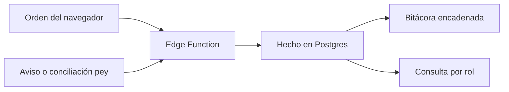
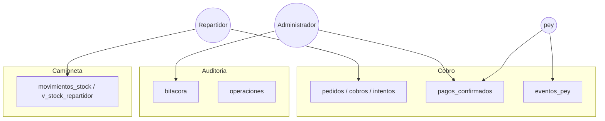
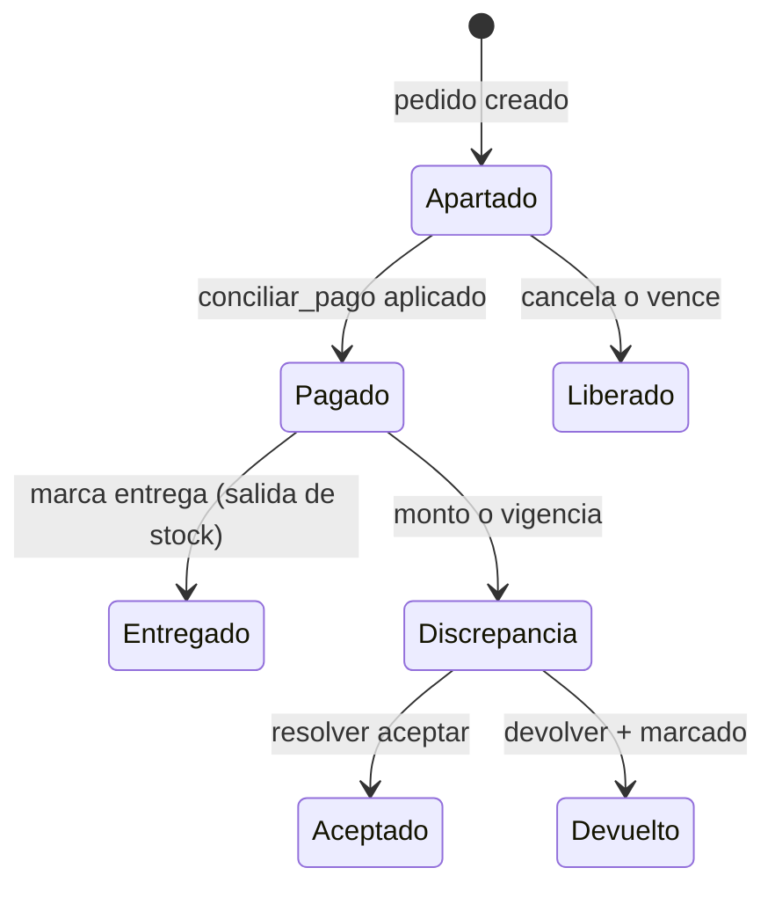

# Cuaderno de datos · Poch

Documento que explica cómo está construido el producto y cómo se comprueba que aplica los principios de datos de Yoltik.

## 1. Qué es y para quién

Poch es una demostración de cobro en ruta con CoDi para una refaccionaria inventada. El **repartidor** arma pedidos desde su celular, muestra un QR y confirma la entrega. El **administrador** ve el día, concilia con pey y resuelve discrepancias. El **cliente** paga desde su banco y puede abrir un comprobante informativo con un enlace largo, sin iniciar sesión.

## 2. Recorrido de un dato

1. El navegador envía una orden con `operacion_id`.
2. La Edge Function valida sesión y cuerpo, llama a una función SQL.
3. La base escribe pedido, stock, cobro o pago **y** la bitácora en la misma transacción.
4. El tablero o el celular consultan por la compuerta (nunca tablas directas).
5. Si el aviso de pey no llega, `conciliar-con-pey` pregunta `GET /transaction/codi/qr/{{qrId}}` y aplica lo faltante.

## 3. Mapa de datos por área y dueño

| Área | Tablas | Dueño operativo |
| --- | --- | --- |
| Identidad | `perfiles` | Administrador |
| Catálogo y stock | `productos`, `movimientos_stock` | Administrador (carga) / repartidor (apartado y salida) |
| Pedido y cobro | `pedidos`, `pedido_lineas`, `cobros`, `intentos_pago` | Repartidor dueño |
| Confirmación | `pagos_confirmados`, `eventos_pey` | Función de servicio / administrador al resolver |
| Prueba | `bitacora`, `operaciones` | Sistema |

## 4. Quién ve qué

| Dato | Repartidor | Administrador | Función de servicio | Navegador directo | Comprobante público |
| --- | --- | --- | --- | --- | --- |
| Pedidos propios | Sí | Sí | Sí | No | Folio y piezas |
| Stock de su camioneta | Sí | Resumen | Sí | No | No |
| Banco y últimos 4 del pagador | Sí | Sí | Sí | No | No |
| Tipo de cuenta del pagador | No | Sí | Sí | No | No |
| CLABE completa | No | No | No (se reduce a 4) | No | No |
| Teléfono del aviso | No (solo se envía a pey) | No | No se guarda | No | No |
| Clave de rastreo | Sí | Sí | Sí | No | Sí |
| Bitácora completa | No | Sí | Sí | No | No |

## 5. Ciclo de vida de un dato hasta su borrado

No hay purga diseñada en esta demostración. Un producto real definiría retención y borrado de avisos y de datos del pagador.

## 6. La bitácora (ejemplo)

Tras un pago aplicado de $0.01:

| Pregunta | Respuesta |
| --- | --- |
| ¿Qué pasó? | `pago_aplicado` |
| ¿Sobre qué? | Pedido y cobro citados en la fila |
| ¿Quién? | `pey:webhook` o `pey:conciliacion` |
| ¿Cuándo ocurrió y cuándo se registró? | `pagado_en` del aviso y `ocurrio_en` de la bitácora |
| ¿Desde dónde? | Función `webhook-pey` o `conciliar-con-pey` |
| ¿Por qué? | Llegó un pago `PAID` con monto igual y dentro de vigencia |
| ¿Bajo qué regla? | Función SQL `conciliar_pago` |

Cada fila lleva la huella de la anterior. `verificar_integridad()` comprueba la cadena.

## 7. Tablero de las nueve reglas

| Regla | Cómo se aplica | Cómo se comprueba | Estado |
| --- | --- | --- | --- |
| Una sola base central | Postgres de Supabase; no hay otra base de cobros | Esquema único en migraciones | Cumple |
| Escritura con identificador propio | `operacion_id` UUID por acción de pantalla | Prueba de repetición en `npm test` | Cumple |
| Historial que no se borra | Triggers de solo agregar en bitácora y movimientos | Intento de `UPDATE`/`DELETE` falla; alteración a fuerza se detecta | Parcial (un administrador de la base puede desactivar triggers) |
| Derivadas reconstruibles | Stock vía `v_stock_repartidor` | `verificar_integridad` | Cumple |
| Escritura solo por la compuerta | RLS sin políticas; revoke a `anon`/`authenticated` | Prueba `anon` sin lectura | Cumple |
| Corte visible | Indicadores del día en zona America/Mexico_City | Tablero | Parcial (no hay corte congelado histórico) |
| Integridad antes que puntualidad | No se marca pagado sin firma y, con `transactionId`, sin confirmación `PAID` | Pruebas de firma y `procesarAviso` | Cumple |
| Cambio gradual | Migraciones aditivas; un ambiente de demo | Archivos en `supabase/migrations/` | Parcial / Fuera para tres ambientes |
| Borrado diseñado | No hay purga de avisos ni de pagos | — | Parcial |

## Glosario

- **Compuerta:** Edge Function que habla con la base; el navegador no escribe tablas.
- **Intento:** Un QR o aviso enviado a pey para un cobro (máximo cinco).
- **Conciliar:** Aplicar o clasificar un pago confirmado contra un cobro.
- **Comprobante del cliente:** Página pública informativa; no es comprobante fiscal.
